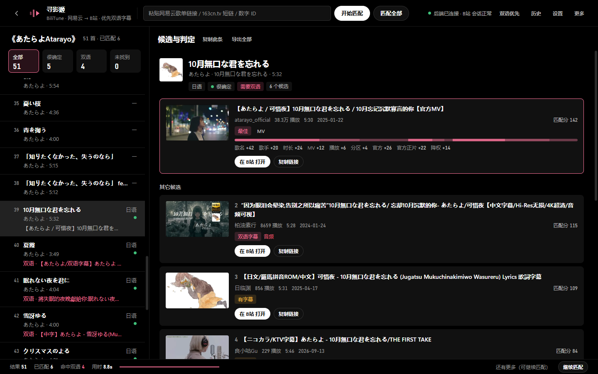
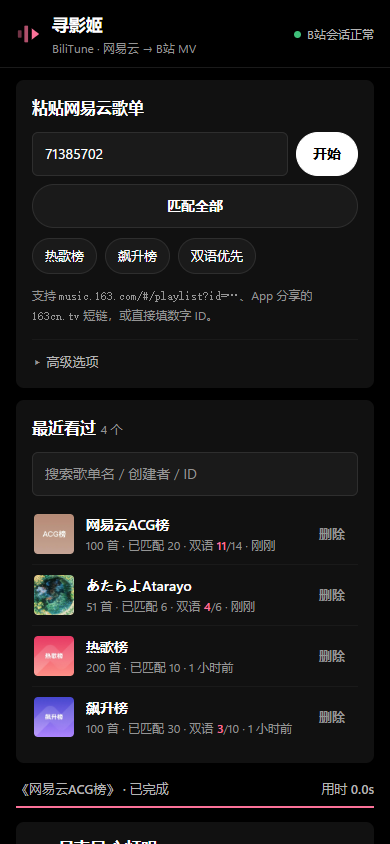

# 寻影姬 BiliTune · 网易云 → B站

给一个网易云音乐歌单，自动在 B站 找到每首歌对应的 MV。
**外语歌优先匹配带中外双语字幕的版本**（中日 / 中英 / 中韩）。



<p align="center">
  
</p>

- 🪟 **Windows 桌面版**：Electron 应用，双击即用，自动拉起本地后端，不需要装 Node
- 🖥 **后端服务**：零第三方依赖的 Node 服务，负责 WBI 签名、cookie 会话、限流重试、多路检索与重排序
- 🌐 **网页版**：后端自带界面，按 User-Agent 自动分发桌面版 / 手机版布局，手机浏览器连局域网就能用

---

## 下载

到 [Releases](https://github.com/yubing0721/bili-mv-finder/releases) 下载：

| 文件 | 说明 |
|---|---|
| `bilitune-x.y.z-portable.exe` | **便携版**，双击即用，不写注册表 |
| `bilitune-x.y.z-setup.exe` | 安装版，会建桌面快捷方式，可从开始菜单卸载 |
| `SHA256SUMS.txt` | 校验值 |
| `bilitune-x.y.z-arm64-v8a.apk` | **Android App**（可选）：默认本机匹配，不需要电脑。App 源码不在本仓库 |

启动时应用会自己拉起本地后端（复用 Electron 内置的 Node），
关掉窗口时自动回收后端进程 —— 不用管端口和命令行。

> 安装包没有代码签名证书，首次运行 Windows 可能弹「SmartScreen 已阻止」，
> 点「更多信息 → 仍要运行」即可。

---

## 功能

界面是纯黑底、单一强调色：层次只靠明度，强调色只出现在数据上（双语命中、匹配分、进度），
主操作反白。桌面与手机共用同一套令牌，各自有适合自己宽度的布局。

```
┌────────────────────────────────────────────────────────────────────┐
│ ← 寻影姬 BiliTune [歌单链接........] [开始匹配] [匹配全部] ● 已连接 双语优先 历史 更多 │
├──────────────────────┬─────────────────────────────────────────────┤
│ 《歌单名》· 851 首     │  晴天 — 周杰伦  4:29   [中文][很确定]        │
│ 全部 很确定 双语 未找到│  ─────────────────────────────────────────  │
│ ──────────────────   │  ┌───────┐ 【4K修复】周杰伦 - 晴天MV         │
│ 01 晴天   周杰伦   ✓  │  │ cover │ 1758.9万播放 · 5:17             │
│ 02 稻香   周杰伦      │  └───────┘ [MV][双语字幕]                   │
│ 03 …                 │  歌名 +42 歌手 +20 时长 +24 官方 +26 正片 +22 │
│                      │  [▶ 在 B站 打开]  [复制链接]                │
│                      │  ── 其它候选 ── / ── 补充关键词重搜 ──       │
├──────────────────────┴─────────────────────────────────────────────┤
│ 结果 851  已匹配 20  命中双语 10  用时 27.1s  [████░░░░]  继续匹配   │
└────────────────────────────────────────────────────────────────────┘
```

- **主从两栏**：左边扫歌单、右边看候选，不用来回滚动；左上角返回键与鼠标侧键都能回到选择歌单
- **左侧筛选**：全部 / 很确定 / 双语 / 未找到，几百首的歌单能快速定位问题条目
- **得分构成可视化**：每条候选摊开显示「歌名 +42 / 歌手 +20 / 时长 +24 / 官方 +26 / 官方正片 +22 / 降权 −14」
- **补充关键词重搜**：匹配不对时加「官方 MV / 中日双语 / 现场」之类的词重搜
- **连续匹配**：点「匹配全部」自动一批接一批，直到整张歌单完成或手动停止
- **双语开关**：顶栏一键切换「双语优先 / 热度优先」；关闭后不再跑双语检索，改按播放量、弹幕量和本家（歌手本人）投稿排序
- **官方账号优先**：唱片公司/官方号 +26，官方正片再 +22；只是名字带 official 的粉丝号只给弱信号
- **浏览历史**：看过的歌单自动记住，可搜索；从历史打开直接显示当时的结果，还能接着匹配
- **导出 CSV**：带 BOM，Excel 打开中文不乱码
- **快捷键**：`↑`/`↓` 切歌、`Enter` 打开最佳候选、`/` 聚焦输入框、`Ctrl+E` 导出、`Ctrl+H` 历史
- 深色一体化窗口：无原生菜单栏，重载/缓存/日志/全屏等收进「更多」
- 窗口尺寸记忆；B站 链接交给系统默认浏览器打开

支持的歌单输入：`music.163.com/#/playlist?id=…` 链接、网易云 App 分享的 `163cn.tv` 短链、纯数字 ID。

---

## 从源码运行

要求 Node ≥ 18（实测 Node 24）。

### 只跑后端 + 网页版

```bash
cd server
node src/index.mjs          # 无需 npm install，只用 Node 内置模块
```

浏览器打开 `http://127.0.0.1:8787`。手机与电脑连同一个 Wi-Fi，
用手机浏览器打开 `http://<电脑局域网IP>:8787` 即可（会自动给手机版布局）。

### 桌面版

```bash
cd desktop
npm install
npm start                   # 开发运行，会自己拉起 ../server 里的后端
npm run dist                # 打包：便携版 + 安装版，产物在 desktop/dist/
```

Windows 下也可以直接双击 `desktop/启动.cmd`，首次运行会自动装依赖。

`extraResources` 会把整个 `server/` 塞进安装包，应用启动时用 `ELECTRON_RUN_AS_NODE=1`
让 Electron 以纯 Node 身份运行后端，所以用户机器上不需要装 Node。

下载 Electron / NSIS 卡住时可以设国内镜像：

```powershell
$env:ELECTRON_MIRROR = 'https://npmmirror.com/mirrors/electron/'
$env:ELECTRON_BUILDER_BINARIES_MIRROR = 'https://npmmirror.com/mirrors/electron-builder-binaries/'
```

### 坑：`ELECTRON_RUN_AS_NODE`

如果终端环境里带着 `ELECTRON_RUN_AS_NODE`（某些开发终端会设），Electron 会以纯 Node 模式启动：
`require('electron')` 返回的是路径字符串，`app`、`BrowserWindow` 全是 `undefined`；
直接带参数运行 exe 还会报 `bad option`。

`main.js` 开头有一段环境自愈：检测到这种状态就清掉该变量、把自己重新拉起一次；
`启动.cmd` 里也显式 `set ELECTRON_RUN_AS_NODE=` 做了双保险。从资源管理器双击 exe 不会遇到。

---

## 为什么需要一个后端

B站 的搜索接口不是能直接调的：

| 障碍 | 说明 |
|---|---|
| WBI 签名 | 搜索类接口必须带 `w_rid`，由 `img_key`/`sub_key` 经置换表 + MD5 生成 |
| cookie 门槛 | 没有 `buvid3` 就直接返回 **412** |
| 风控软拦截 | 返回 `code: 0, message: "OK"`，但 `data` 里只有 `v_voucher` 没有 `result` —— **看起来成功，实际什么都没给** |
| 限流 | 请求过快会被拒，需要串行 + 退避 |
| 图片防盗链 | 封面图带非 B站 的 Referer 会 403，页面统一用 `no-referrer` |

---

## 它是怎么找的

核心难点不是"调接口"，而是**排序**。B站 自带的 `totalrank` 对这个场景很不准 ——
实测搜 `米津玄師 Lemon MV`，前排混进 Reaction、教唱、KTV 伴奏、花絮。

```
网易云歌单
   │
   ├─ 拉歌词 ────→ 语种判定（日语必有假名、韩语必有谚文）
   │
   ├─ 多路并发检索（同一首歌发 3~5 条不同关键词）
   │     · bilingual       歌名 + 歌手 + 中日双语
   │     · bilingual_mv    歌名 + 歌手 + MV + 中日双语
   │     · bilingual_alias 原文名 + 双语关键词（应对"网易云给译名、B站用原文名"）
   │     · base / base_mv  只保证歌对了
   │     · official        歌名 + 歌手 + 官方 MV
   │
   ├─ 融合去重（记录每个候选被哪几路召回）
   │
   └─ 本地重排序
        歌名命中 42   ← 以【标题】为准，简介/标签只给 55%
        歌手命中 20
        时长吻合 24   ← 与网易云音频时长对比
        MV 特征  12   ← MV / Official / 1080P / 4K / 修复 / 分区
        双语字幕 30   ← 外语歌核心诉求，并做【语种对齐】
        播放量    7   ← 对数缩放，弱信号
        官方账号 26   ← 官方号/唱片公司；官方正片再 +22
        字幕组   12   ← 正规字幕组；未验证的 official 标识仅 +6
        负向扣分      ← 合集/翻唱/教学/二创/花絮/现场/改写版/曲谱…
                          外语歌无字幕再额外 -14
      关闭双语优先：不跑双语路，播放 26 + 弹幕 12 + 本家投稿 24
```

几个关键取舍：

1. **双语权重比 MV 信号还高，且没字幕要扣分。** 否则高播放的无字幕官方 MV 会永远压过双语版。
2. **双语识别做语种对齐。** 日语歌匹配到「中英字幕」的视频多半是英文改编版，只给一半分。
3. **歌名必须命中标题。** 简介噪声极大（Adele《Hello》曾匹配到一档简介里有 "hello" 的综艺合集）。
4. **歌名/歌手匹配支持繁简与异体。** 「米津玄師」与「米津玄师」用窗口式 LCS 模糊匹配。
5. **双语字幕识别用结构特征**（语言对 + 字幕词 + 双语词的组合），不用固定短语清单。
6. **风控软拦截必须显式识别**：重建会话（换新 buvid）、退避重试最多 4 轮。
7. **官方/本家优先，但不能被名字骗。** `atarayo_official` 这类官方号优先；`阿赫official` 这种粉丝号不算，名字里带 official 但没有 MV 标识只给弱信号。

---

## 接口

| 方法 | 路径 | 说明 |
|---|---|---|
| GET | `/api/health` | 健康检查，含 B站 会话状态与风控计数 |
| GET | `/api/playlist?id=` | 解析歌单。支持链接、`163cn.tv` 短链、纯数字 ID |
| GET | `/api/match/stream?id=&limit=&offset=&preferBilingual=` | **SSE 流式匹配** |
| POST | `/api/match` | 一次性 JSON 匹配。可传 `tracks` 直接指定歌曲 |
| GET | `/api/search?title=&artist=&duration=&lang=&extra=` | 单曲重搜 |
| GET | `/api/video?bvid=` | 视频详情 |
| GET | `/api/lang?title=&artist=&id=` | 语种判定 + 会用到哪些检索词 |
| POST | `/api/cache/clear` | 清空缓存 |
| GET | `/api/history?q=&limit=` | 看过的歌单，按最近浏览倒序 |
| GET | `/api/history/item?id=` | 历史快照：歌单 + 已匹配结果 |
| POST | `/api/history/delete?id=` | 删除一条历史 |
| POST | `/api/history/clear` | 清空历史 |
| GET | `/`、`/desktop`、`/mobile` | 网页界面 |

`preferBilingual=0` 关闭双语优先：不再生成双语检索路，改按播放量、弹幕量、本家投稿和官方账号排序。

## 配置

后端通过环境变量配置：

| 变量 | 默认 | 说明 |
|---|---|---|
| `PORT` | `8787` | 监听端口（桌面版用 `BMF_PORT` 指定） |
| `HOST` | `0.0.0.0` | 监听地址（`0.0.0.0` 才能被手机访问） |
| `BILI_MIN_INTERVAL_MS` | `250` | B站 请求最小间隔，调大可降低风控概率 |
| `MATCH_CONCURRENCY` | `3` | 同时匹配几首歌 |
| `CACHE_DIR` | `server/.cache` | 缓存目录（桌面版在 `%APPDATA%\bili-mv-finder-desktop\cache`） |
| `CACHE_TTL_MS` | 12 小时 | 缓存有效期 |
| `HISTORY_DIR` | `$CACHE_DIR/history` | 浏览历史目录，「清空缓存」不会删它 |
| `DEBUG_BILI` | — | 设为 `1` 打印 B站 请求细节 |

服务会打印访问日志，方便判断「请求根本没到」还是「到了但出错」：

```
[api] GET  /api/match/stream?id=3778678&limit=20&offset=0 → 200 58270ms  from 192.168.1.23
```

---

## 开发者工具

```bash
cd server
node tools/eval.mjs              # 用 12 首中日英韩歌曲评估匹配质量
node tools/eval.mjs --only=ja    # 只跑日语用例
node tools/test-api.mjs 3778678 6   # 端到端测 HTTP 接口
node tools/test-sse.mjs 3778678 5   # 测 SSE 流式
node tools/diagnose-raw.mjs         # 看 B站 原始响应（排查风控）
node tools/diagnose-query.mjs       # 测不同查询的召回情况
```

桌面版 UI 可以程序化验证（通过 Chrome DevTools Protocol 读取窗口 DOM，23 项断言）：

```bash
cd desktop
node_modules\electron\dist\electron.exe . --remote-debugging-port=9222
node scripts/verify-ui.mjs           # 另一个终端
```

最近一次评估：语种识别 12/12，Top1 标题精确含歌名 12/12，外语歌 Top1 带双语字幕 8/9，平均单曲 1.5s。

---

## 已知限制

- **依赖 B站 非公开接口。** WBI 签名和搜索接口不是正式 API，随时可能变动；风控已做识别与重试，但无法保证 100% 可用。
- **匹配不可能全对。** 有些歌在 B站 没有官方 MV，有些歌名过于通用（《Hello》《晴天》）。所以界面始终展示候选列表和置信度。
- **时长信号会说谎。** 官方 MV 与专辑音频时长差有时很大，这时时长分会拖后腿。
- **匹配耗时偏长。** 为了不被风控，B站 请求串行限流（默认 250ms/次），20 首约 30~70 秒；结果会缓存，同一歌单再次打开很快，历史记录里的歌单则是瞬间打开。
- **官方优先会改变排序取舍。** 官方账号发布正片时会排在饭制双语版前面；如果更看重双语，可使用关闭双语开关之外的默认模式（默认仍是双语优先）。
- **只打包了 Windows x64**，没有代码签名。Windows on ARM 需要加 `--arm64` 重新构建。

## 目录结构

```
├── desktop/                 # Windows 桌面版（Electron）
│   ├── main.js              # 主进程：拉起后端 + 建窗口 + 环境自愈
│   ├── preload.js           # 只暴露打开日志/关于/退出等原生动作
│   ├── 启动.cmd              # 双击启动（自动装依赖）
│   ├── build/               # 应用图标
│   └── scripts/             # CDP 截图与 UI 验证
└── server/                  # 后端（零第三方依赖）
    ├── src/
    │   ├── index.mjs        # HTTP 服务、路由、SSE、访问日志
    │   ├── bilibili.mjs     # B站 客户端：WBI 签名、会话、风控处理
    │   ├── netease.mjs      # 网易云歌单与歌词
    │   ├── match.mjs        # ★ 核心匹配算法
    │   ├── lang.mjs         # 语种识别、双语关键词策略、负向词典
    │   ├── text.mjs         # 文本归一化、模糊匹配、时长解析
    │   ├── officialUps.mjs  # 官方账号识别
    │   ├── history.mjs      # 浏览历史与结果快照
    │   ├── cache.mjs        # 内存 + 磁盘缓存
    │   └── http.mjs         # cookie jar、限流器、重试
    ├── public/
    │   ├── desktop.html     # 桌面版界面
    │   ├── index.html       # 手机版界面
    │   └── favicon.png      # 网页图标
    └── tools/               # 评估与诊断工具
```

## 法律与使用边界

本项目只做**检索与跳转**：解析公开的歌单信息，在 B站 搜索公开视频，然后给出链接。
它不下载、不转存、不绕过任何付费或版权限制。播放行为发生在 B站 内，
版权归原权利人所有。请合理控制请求频率，不要用于批量抓取。

## 许可证

[MIT](LICENSE)
